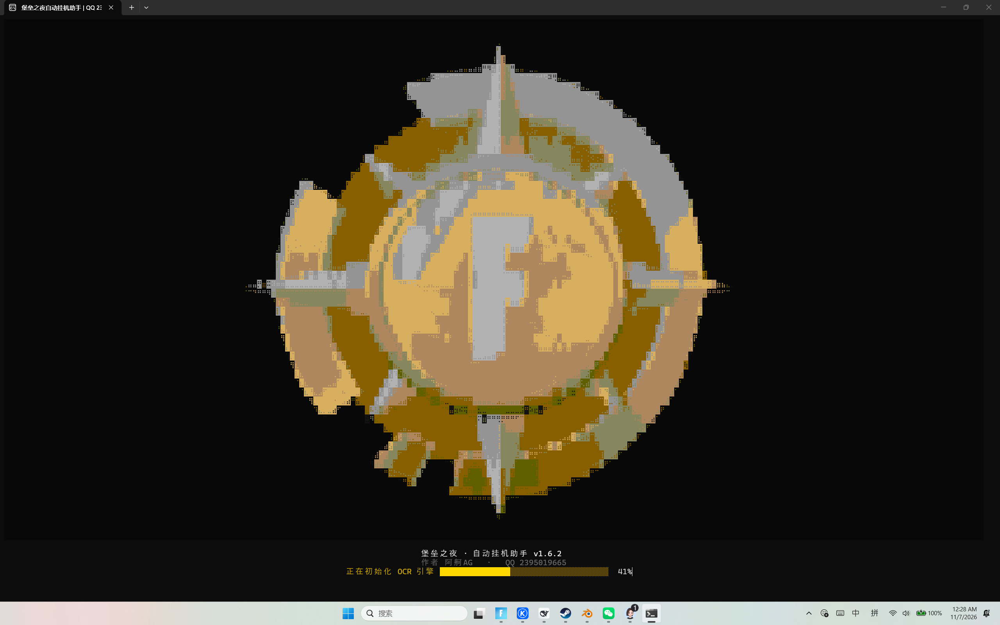
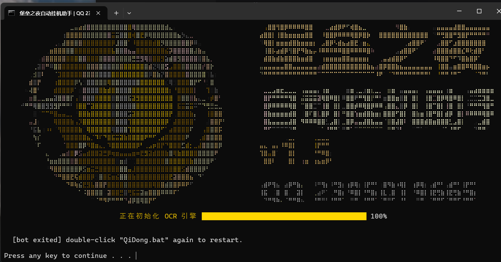

# 堡垒之夜 · 自动挂机助手（Windows OCR 版）

> 一个纯 OCR + 键鼠模拟的《堡垒之夜》自动挂机小工具：自动点开始、自动跳伞、自动打满一局、自动结算、自动开下一局，全程不需要读游戏内存、不注入进程。





- 版本：**v1.12.1**
- 平台：Windows 10 / 11（x64）
- 作者：**阿舸AG** · QQ **2395019665**
- 遇到 bug / 报错：加 QQ 并把 `bot_log.txt` 一起发我

---

## ⚠️ 免责声明（请先看这一段）

1. 本项目仅供 **编程学习 / 自动化技术研究** 使用。
2. 《堡垒之夜》的用户协议通常**不允许**第三方自动化工具，使用本工具可能导致**封号、清零、禁赛**等后果，**风险自负**。
3. 本项目 **不读取游戏内存、不修改游戏文件、不注入 DLL**，只做「截屏 + OCR 识别 + 模拟键鼠」，但**这不代表它一定安全或合规**。
4. 请勿用于代练、售卖、账号交易等任何商业用途。因使用本工具产生的一切后果由使用者承担。
5. 本项目与 Epic Games 无任何关联，相关游戏名称、图标版权归 Epic Games 所有。

---

## 它到底做什么

一句话：**看屏幕上的字，然后像人一样点鼠标、按键盘。**

循环长这样：

```
大厅看到「开始」        → 点开始（3 秒冷却）
「搜索服务器」          → 匹配中，等
「连接中 / 大逃杀」      → 加载，等
「正在等待玩家」        → 等待区，等
战斗巴士（倒计时）       → 到点按空格跳伞
跳伞 / 落地            → 等落地
局内                  → 做反挂机动作（走、转视角、跳、表情、朝队友跑）
被淘汰 / 观战          → 什么都不点，等队友打完
结算页「返回大厅」       → 点返回大厅（3 秒冷却）
回到大厅               → 继续下一局
```

## 功能一览

| 功能 | 说明 |
|---|---|
| 自动开局 | 识别大厅「开始」按钮并点击，支持「文字在哪点哪」+ 锚点兜底 |
| 自动匹配 / 加载 / 等待 | 状态机自动识别，不误触 |
| 自动跳伞 | 读巴士右上倒计时，到设定秒数按空格 |
| 反挂机动作 | 每 15 秒一串 8~20 秒动作：走路、平滑转视角、跳跃、冲刺跳、挖矿、跳舞、切武器 |
| 自动朝队友跑 | 识别队友名牌 → 转向 → 按住 W+奔跑 10~20 秒，途中跳跃 |
| 自动交互 | 画面出现「搜索 / 打开 / 拾取」→ 按交互键（默认 C） |
| 自动召回小队 | 画面出现「召回小队」→ 按 G |
| 自动跳过 | 任何带「跳过 / 略过 / SKIP」的浮层 → 点掉 |
| 自动领取弹窗 | 「领取 / 确定 / 确认」→ 点掉 |
| 自动休眼处理 | 出现「已进入休眠模式」→ 点「继续游戏」 |
| 队伍人数保护 | 队伍不足 3 人（含自己）自动退出重排；自己活着才算，绝不提前退局 |
| 断线 / 未开游戏识别 | 区分「未开游戏」和「游戏在跑但窗口找不到」，会自己重试 |
| 自动检查更新 | 启动时对比 GitHub 最新 Release，有新版本可一键下载到「下载」文件夹并自动打开 |
| 结算后行为 | 可切换「返回大厅」或「再玩一次」，启动器按 15，设置持久化 |
| 日志 & 统计 | `bot_log.txt` 记录每一步；`stats.txt` 记录已完成局数 |
| 按键绑定 | 跳跃/奔跑/稿子/动作/交互/召回小队 都能在界面里改键 |
| 自定义点击词 | 你写什么词，画面出现就点哪里 |

## 快速开始（3 步）

1. 下载仓库右侧 **Releases** 里的 `fortnite-auto-helper_v1.12.1.zip`（约 21 MB，**已内置 Python 运行时，不用装 Python**）。
2. 解压到任意文件夹（路径别带特殊符号），双击 **`启动.bat`**。
3. 先按 **`4`** 回车填上**你自己的游戏 ID**（必须和左下角队伍栏显示的一致，否则认不出你，反挂机不会启动），然后按 **`1`** 回车开始挂机。

> 游戏要用 **窗口化 / 无边框窗口**，别用独占全屏；分辨率与缩放不影响（程序按屏幕百分比找字）。

> 项目主页（新版本都发在这里）：**https://github.com/Ajiuwu101213/fortnite-auto-helper**
> 启动后的命令框底部也会显示这一行，按 `13` 回车可直接打开。

### 快捷键

| 键 | 作用 |
|---|---|
| `F10` | 开始自动打 |
| `F9` | 停止自动打（待命时再按一次 = 退出脚本） |
| `1` / `2` / `3` | 开始挂机 / 停止挂机 / 退出程序 |
| `10` | 按键绑定（改键） |

## 它是怎么"看"的（技术原理）

没有内存读取，只有三件事：

1. **截屏**：`PIL.ImageGrab` 抓全屏（约 40 ms）
2. **文字识别**：调用 Windows 自带 OCR（`Windows.Media.Ocr`，约 0.5 秒），中文字之间常被插空格，所以会先做归一化
3. **状态机 + 模拟键鼠**：`ctypes` 调 `SendInput` 发扫描码/鼠标事件，点击位置取 **OCR 文字框中心**（不是写死坐标）

几个关键判据：

- **是否在局内**：左上任务条 HUD 词 + 顶部方位条 + **左下角自己名字**（三重任选）
- **我死了没有**：屏幕上出现「正在观战 / 上一个队友 / 等待重启」，或左下角自己名字**变红/变灰**
- **队友死没死**：看左下角队伍栏每个名字的**颜色**（白=活，红/灰=死）
- **队伍几个人**：数队伍栏行数（OCR 行 + 像素行双保险）
- **结算页 vs 局内菜单**：两者都有「返回大厅」，靠有没有「进入睡眠模式」区分，且结算页必须有「比赛回顾/你的排名/经验值」等标记

## 目录结构

```
堡垒之夜自动挂机/
├─ 启动.bat            # 双击入口（最大化开一个控制台）
├─ launcher.py          # 控制台界面、菜单、状态显示、开/停机器人
├─ fortnite_bot.py      # 机器人本体：截屏→OCR→状态机→点/按键
├─ splash_gen.py        # 开场动画的图案生成（运行时按窗口大小生成）
├─ splash_art.py        # 旧版半块字符画（备用）
├─ splash_braille.py    # 旧版盲文点阵（备用）
├─ install_ocr.ps1      # 一键安装 Windows 中文 OCR（需管理员）
├─ logo.png             # 开场图案
├─ 使用说明.txt          # 给用户的详细说明（很全，建议先看）
├─ 技术说明.md           # 给开发者/想改代码的人看的实现细节
└─ python/              # 内置 Python 运行时（Release 包里才有，仓库里没有）
```

## 配置文件在哪

v1.7.7 起，所有个人设置都存在：

```
%LOCALAPPDATA%\FortniteAutoBot\
├─ 设置.txt        # 按键绑定、视角灵敏度、点击冷却、队伍策略
├─ 玩家名字.txt     # 你的游戏 ID
├─ 点击词.txt       # 自定义「看到就点」的词
└─ matches.txt     # 对局统计（换版本不丢）
```

换新版本时这些文件**不会被覆盖**，旧版本设置会自动迁移。

## 常见问题

**Q：杀毒软件报毒？**
A：脚本会模拟键鼠、读写文件，属于常见误报。可加白名单，或自己看源码后运行。

**Q：显示「未开游戏」但我明明开了？**
A：先确认游戏没最小化；程序会先找窗口，再找进程，都不行才报「未开游戏」。依旧不行请把 `bot_log.txt` 发我。

**Q：中文 OCR 缺失？**
A：在启动器里按 `6` 一键安装（会弹 UAC），或手动到「设置 → 时间和语言 → 语言 → 中文(简体) → 语言功能」里装。

**Q：会不会误点「返回大厅」退出还没结束的对局？**
A：不会。观战页有「正在观战/上一个队友」等专属文字，且「返回大厅+进入睡眠模式」= 菜单（不点）；只有结算页（带「比赛回顾/你的排名/经验值」）才会点「返回大厅」。

**Q：它会不会开枪打人？**
A：反挂机里会随机点左键（可能被当开枪），但它**不会瞄准、不会主动攻击**，设计目标就是「挂机不掉线」。

## 更新记录（简表）

| 版本 | 主要变化 |
|---|---|
| v1.12.1 | 结算后行为可切换：**返回大厅**（默认）或**再玩一次**，启动器 `[15]`，设置持久化 |
| v1.12.0 | 启动自动检查更新：有新版本可以直接下载到「下载」文件夹并自动打开；菜单 [14] 手动检查 |
| v1.11.7 | 命令框底部常驻**项目主页（更新地址）**；菜单新增 `[13] 打开项目主页` |
| v1.11.7 | 修复环境光染色导致“自己名字被判成红色→误判死亡→不动作”；观战不再被当成结算页；`3` 一键退出并结束后台所有挂机进程 |
| v1.11.0 | 每帧先判画面状态（大厅/匹配/加载/巴士/跳伞/局内/观战/结算/菜单/弹窗），只有「局内+活着」才反挂机 |
| v1.10.9 | 反挂机五道门：INGAME + 无观战字样 + 无结算字样 + alive + 前台 |
| v1.10.8 | 新增「自己名字变红/变灰 = 已死」判据（名字读不出时按记住的位置看颜色） |
| v1.10.7 | 观战页靠「观战字样」硬判；疑似结算页观察 8→4 秒 |
| v1.10.6 | 所有点击间隔硬上限 3 秒 |
| v1.10.2 | 点击节奏可调（反应时间、冷却） |
| v1.9.x | 名字颜色判队友死活、队伍人数双机制、去写死坐标、闭环瞄准 |
| v1.8.x | 朝队友冲刺（按稿子→W 全程不松→途中跳）、按键绑定 |
| v1.7.x | F9/F10 加固、设置持久化、启动器审计修复 |
| v1.6.x | 全屏点阵开场动画、自定义点击词、DPI 修复 |
| v1.5.0 | 首个可用版本（自动开局/跳伞/结算/循环） |

## 作者 & 反馈

- 作者：**阿舸AG**
- QQ：**2395019665**（有 bug / 报错请附上 `bot_log.txt`）
- 欢迎 Issue / PR；但请注意上面那条免责声明。

## License

[MIT](LICENSE)（仅限代码；游戏名称、图标等版权归 Epic Games 所有）

> 附加声明（游戏素材归属、使用风险、禁止代售）见 [NOTICE](NOTICE)。
